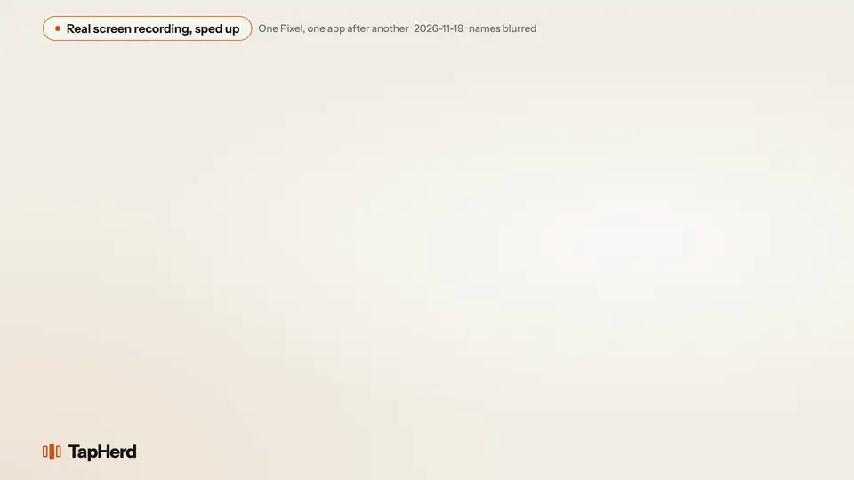

# TapHerd

**Your AI can now use Android apps.**

TapHerd is a free, open-source connector that lets Codex, Claude, Cursor, or any MCP client control your Android phones and emulators. Your AI sees the screen, taps, types, opens apps, and copies media, on up to three devices for free.



*Real screen recording, sped up, account names blurred: one prompt posted a scheduled video from one Pixel emulator to three platforms on 2026-11-19.*

**Website and illustrated guide: [tapherd.info](https://tapherd.info)** · macOS: tested · Windows and Linux: beta

## Install

You need a computer and an Android device: a free emulator from Android Studio, or your own phone with USB debugging on. [How to get the emulator](https://tapherd.info/docs.html#emulator)

```sh
# macOS and Linux
curl -LsSf https://raw.githubusercontent.com/GreenPeaas/tapherd/main/scripts/install.sh | sh
```

```powershell
# Windows (PowerShell, no administrator rights needed)
irm https://raw.githubusercontent.com/GreenPeaas/tapherd/main/scripts/install.ps1 | iex
```

The installer sets up [uv](https://docs.astral.sh/uv/) and TapHerd for your user, offers to install Android's `adb` tool, and runs `tapherd doctor`. It explains and asks before anything that needs `sudo`. [Read the macOS/Linux installer](scripts/install.sh) · [Read the Windows installer](scripts/install.ps1)

Already have uv? Run `uv tool install tapherd`, then `tapherd doctor`. For the latest code from this repository, run `uv tool install git+https://github.com/GreenPeaas/tapherd` instead.

`tapherd doctor` lists your Python, `adb`, and online devices, and ends with **Ready** when everything works. If something is missing, it tells you the next command to run.

## Your first AI-controlled tap

1. **Connect your AI.** Print the settings for your client and paste them where TapHerd says. [Steps for each client](docs/CONNECT_YOUR_AI.md)

   ```sh
   tapherd config mcp --client claude-code     # or codex, claude-desktop, cursor
   ```

2. **Ask it to do something:**

   > Use TapHerd to list my devices. On the first one, open Settings, read the screen, tap **Network & internet**, and tell me what opened.

   You should see **Network & internet** open on the device.

New to this? Follow the [step-by-step guide](docs/GETTING_STARTED.md).

### Or try it in one command with Claude Code

This uses a temporary MCP config and only the four tools it needs. `tapherd config mcp` also prints a reminder about where to save the config; the command below already saves it for you, so you can ignore that line.

```sh
TAPHERD_FIRST_TAP_DIR=$(mktemp -d)
tapherd config mcp --client claude-code > "$TAPHERD_FIRST_TAP_DIR/mcp.json"
(
  cd "$TAPHERD_FIRST_TAP_DIR" || exit
  claude --print \
    'Use only TapHerd MCP. List devices. On the first active device, open com.android.settings, use read_screen to find Network & internet, tap that row, and tell me what opened.' \
    --mcp-config "$TAPHERD_FIRST_TAP_DIR/mcp.json" --strict-mcp-config \
    --no-session-persistence --tools '' \
    --allowedTools mcp__tapherd__list_devices mcp__tapherd__open_app \
      mcp__tapherd__read_screen mcp__tapherd__tap
)
```

Menu labels can vary by Android version or language. If Settings opens on a subpage, go back to its home screen and try again.

## What it's for

- **Posting.** Post a video to TikTok, Instagram Reels, and YouTube Shorts from your phones, with captions your AI writes. The same tools work in other apps, such as X and the main YouTube app.
- **QA testing.** Let an agent walk through your Android app on several emulators at once.
- **Store screenshots.** Capture the same screens on several devices.
- **Mobile-only apps.** Use apps that have no web or API version.
- **Your own analytics.** Read numbers from your own accounts' in-app dashboards.

TapHerd only acts on devices you connect, through apps you're signed into. Its recipes only support posting to accounts you own. [Acceptable use](docs/ACCEPTABLE_USE.md)

## Free and Pro

| | Free (this repository, MIT) | Pro (planned) |
| --- | --- | --- |
| Active devices | Up to 3 | 50+ |
| AI control of any Android app | ✓ | ✓ |
| Posting recipes | 1 sample (unverified) | Maintained recipe library |
| Scheduling | Run on demand | Scheduled posting |
| Dashboard and browser control | — | Planned |

[Try the interactive Pro concept](https://tapherd.info/#pro) or run `tapherd pro` to join the waitlist. The CLI shows a short Pro notice at most once a day; set `TAPHERD_NO_TEASE=1` to turn it off.

## Docs

| Get started | Use it | Project |
| --- | --- | --- |
| [Step-by-step guide](docs/GETTING_STARTED.md) | [MCP tools](docs/TOOLS.md) | [Security and data flow](docs/SECURITY.md) |
| [Setup on macOS](docs/SETUP_MAC.md) | [Recipes](docs/RECIPES.md) | [Acceptable use](docs/ACCEPTABLE_USE.md) |
| [Setup on Windows (beta)](docs/SETUP_WINDOWS.md) | [Advanced MCP options](docs/MCP.md) | [Contributing](CONTRIBUTING.md) |
| [Setup on Linux (beta)](docs/SETUP_LINUX.md) | [Architecture](docs/ARCHITECTURE.md) | [Changelog](CHANGELOG.md) |
| [Connect your AI](docs/CONNECT_YOUR_AI.md) | [Troubleshooting](docs/TROUBLESHOOTING.md) | [License (MIT)](LICENSE) |

## Privacy

The connector runs entirely on your computer and has no telemetry. Screenshots and the optional action log stay local. TapHerd never asks for or stores passwords; you sign in to apps on the device yourself. [Security and data flow](docs/SECURITY.md) · [Website privacy](https://tapherd.info/privacy.html)

## Help

Open an [issue](https://github.com/GreenPeaas/tapherd/issues/new/choose) with the output of `tapherd doctor`, or email support@tapherd.info. Report security problems privately: [how](docs/SECURITY.md#report-a-vulnerability).

---

TapHerd is not affiliated with or endorsed by TikTok, Meta, Google, or X. All trademarks belong to their owners.
